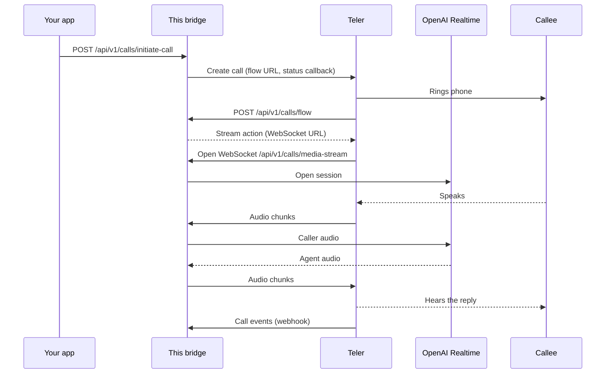

# Teler OpenAI Bridge

[](LICENSE) [](https://www.python.org/downloads/)  [](https://frejun.com/docs/teler/)

A reference integration between **Teler** and **OpenAI Realtime API**, based on media streaming over WebSockets.

## What is Teler?

Teler is a programmable voice API by FreJun. It handles carriers, phone numbers, and real-time audio streaming so you can connect AI models directly to phone calls. → [FreJun-Teler](https://frejun.com/teler/)

## About

This project is a reference implementation to bridge **Teler** and **OpenAI Realtime API**. It enables real-time media streaming over WebSockets, facilitating live audio interactions.

---

## What you can build

- A speech-to-speech phone agent built on OpenAI Realtime models
- Outbound calls such as appointment confirmations, surveys or lead qualification
- A Python base for adding tools and custom instructions to a Realtime session on phone calls

The included `POST /api/v1/calls/initiate-call` endpoint places **outbound** calls. For **inbound** calls, point your Teler number's voice app at this server's `/api/v1/calls/flow` endpoint (see [Voice apps](https://frejun.com/docs/teler/telephony/voice-apps/)).

## How it works



1. Your app calls `POST /api/v1/calls/initiate-call`. The bridge asks Teler to place the call, passing its own flow URL and webhook URL (both built from `SERVER_DOMAIN`).
2. When the call connects, Teler requests `/api/v1/calls/flow`, and the bridge answers with a **stream** action that points Teler to its WebSocket.
3. Teler opens a WebSocket to `/api/v1/calls/media-stream` and starts sending the caller's audio.
4. The bridge opens a session with OpenAI Realtime WebSocket (`OPENAI_WS_URL`).
5. Audio flows both ways: caller audio is forwarded to OpenAI Realtime, and OpenAI Realtime's audio is sent back to Teler.
6. Audio is resampled where the rates differ: OpenAI (24 kHz) → Teler (8 kHz).
7. Outgoing audio is buffered (`BUFFER_SIZE`) so Teler receives evenly sized chunks.
8. Call status events are delivered to `/api/v1/webhooks/receiver`.

More detail: [How media streaming works](https://frejun.com/docs/teler/media-streaming/how-it-works/) and [WebSocket protocol](https://frejun.com/docs/teler/media-streaming/websocket-protocol/).

## Features

- Real-time streaming of media via WebSockets
- Bi-directional communication between Teler client and OpenAI Realtime API
- Sample structure for deployment (Docker, environment variables)
- Basic error handling and connection management
- Converts OpenAI 24kHz audio to Teler 8kHz

---

### Prerequisites

Ensure you have the following installed / available:

- Python 3.x
- Docker & Docker Compose
- Valid API credentials / access:
  - Teler account / API key / endpoints (frejun account)
  - OpenAI API access

#### Runtime and network requirements

- **Provider credentials:** OpenAI API key with Realtime API access
- **Runtime:** Docker and Docker Compose (recommended). To run without Docker: Python 3.11 (the Docker image uses `python:3.11-slim`).
- **Public HTTPS/WSS endpoint:** Teler must reach this server from the internet for the flow URL, the media WebSocket and webhooks. The Docker setup uses ngrok for this; in production, use your own domain with TLS.
- **Outbound internet access** from the server to the Teler API and to the provider's API.
- **Ports:** `8000` (app) and `4040` (ngrok inspector) must be free on the host when using Docker Compose.


---

## Setup

1. **Clone and configure:**

   ```bash
   git clone https://github.com/frejun-tech/teler-openai-bridge.git
   cd teler-openai-bridge
   cp .env.example .env
   # Edit .env with your actual values
   ```

2. **Run with Docker:**
   ```bash
   docker compose up -d --build
   ```

### Run without Docker (local development)

```bash
python -m venv .venv
source .venv/bin/activate   # Windows: .venv\Scripts\activate
pip install -r requirements.txt
uvicorn app.main:app --host 0.0.0.0 --port 8000
```

In a second terminal, expose the server with `ngrok http 8000`. Outside Docker the app cannot auto-detect the ngrok URL (it looks for the `ngrok` container), so set `SERVER_DOMAIN` in `.env` to the ngrok hostname, without `https://`, before starting the server.

### Verify it is running

```bash
curl http://localhost:8000/health
curl http://localhost:8000/ngrok-status
```

Then place a test call with the request in **Call Initiation Example**.

## Environment Variables

| Variable          | Description                       | Default  |
| ----------------- | --------------------------------- | -------- |
| `OPENAI_API_KEY`  | Your OpenAI API key               | Required |
| `TELER_API_KEY`   | Your Teler API key                | Required |
| `SERVER_DOMAIN`   | Your ngrok domain (auto-detected) | Required |
| `NGROK_AUTHTOKEN` | Your ngrok auth token             | Required |

### Required vs optional settings

These values are taken from the code (`app/core/config.py`). Where this table and the table above differ, the code is what runs. Settings are loaded with `pydantic-settings`, so variable names are case-insensitive: `OPENAI_API_KEY` and `openai_api_key` both work.

| Variable | Required | Default | Description |
|---|---|---|---|
| `TELER_API_KEY` | Required | — | Teler API key, used to place calls through the Teler API |
| `OPENAI_API_KEY` | Required | — | OpenAI API key |
| `OPENAI_WS_URL` | Optional | `wss://api.openai.com/v1/realtime?model=gpt-realtime-2.1` | OpenAI Realtime WebSocket URL |
| `NGROK_AUTHTOKEN` | Required with Docker | — | ngrok auth token, read by the `ngrok` container in `docker-compose` (not by the app itself) |
| `SERVER_DOMAIN` | Optional | auto-detected | Public hostname of this server, without `https://`. Auto-detected from ngrok when it is running; set it yourself when deploying without ngrok |
| `SERVER_HOST` | Optional | `0.0.0.0` | Interface the server binds to |
| `SERVER_PORT` | Optional | `8000` | Port the server listens on |
| `LOG_LEVEL` | Optional | `INFO` | Log verbosity |
| `BUFFER_SIZE` | Optional | `20` | Audio chunks buffered before forwarding |

## API Endpoints

- `GET /` - Health check with server domain
- `GET /health` - Service status
- `GET /ngrok-status` - Current ngrok status and URL
- `POST /api/v1/calls/initiate-call` - Start a new call with dynamic phone numbers
- `POST /api/v1/calls/flow` - Get call flow configuration
- `WebSocket /api/v1/calls/media-stream` - Audio streaming between teler and openai
- `POST /api/v1/webhooks/receiver` - Teler → OpenAI webhook receiver

### Call Initiation Example

```bash
curl -X POST "http://localhost:8000/api/v1/calls/initiate-call" \
  -H "Content-Type: application/json" \
  -d '{
    "from_number": "+1234567890",
    "to_number": "+0987654321"
  }'
```

## Troubleshooting

**`initiate-call` returns an authentication error from Teler.**
Check `TELER_API_KEY` in `.env`, then restart the container so it picks up the change. Keys are managed in the [Teler dashboard](https://platform.frejun.ai).

**The phone rings, but there is silence after answering.**
Teler could not reach the flow URL or the WebSocket. Open `/ngrok-status` and confirm a public URL is listed. If you are not using ngrok, set `SERVER_DOMAIN` to your public hostname without `https://`.

**`/ngrok-status` shows no tunnel.**
Check that `NGROK_AUTHTOKEN` is set and look at the ngrok container logs (`docker compose logs ngrok`). The free ngrok plan gives a new URL on every restart, so place calls only after the tunnel is up.

**The connection to OpenAI Realtime fails or closes immediately.**
Check the OpenAI Realtime credentials in `.env` (see **Required vs optional settings**) and the app logs (`docker compose logs app`) for the provider's error message.

**Audio is choppy or delayed.**
Tune `BUFFER_SIZE`. Smaller values reduce latency; larger values smooth playback.

**Running outside Docker, the app reports no server domain.**
The Python app looks for ngrok at `http://ngrok:4040`, which only exists inside Docker Compose. Set `SERVER_DOMAIN` manually.

**`Bind for 0.0.0.0:8000 failed: port is already allocated`.**
Another process is using port 8000 or 4040. Stop it, or change the host port mapping in `docker-compose`.

## Security

- **Keep secrets out of git.** Store keys only in `.env`, which is listed in `.gitignore`. Never commit real keys, and use placeholders in examples and issues.
- **Rotate keys** if you suspect a key was exposed, and use separate keys for development and production.
- **Protect the call-initiation endpoint.** `POST /api/v1/calls/initiate-call` has no authentication in this reference code, so anyone who can reach your public URL can place calls billed to your Teler account. Before exposing the server, add authentication (an API key header, for example) or restrict access by IP.
- **The flow, media and webhook endpoints are not verified** in this reference code. In production, keep the server behind your own domain and validate incoming requests.
- **Use ngrok only for development.** In production, deploy behind your own domain with TLS (`https://` and `wss://`).
- **Call recording is on by default** in this bridge. Make sure you have the consent your jurisdiction requires, or turn recording off.
- **Logs can contain call details** such as phone numbers and transcripts. Set `LOG_LEVEL` appropriately and handle logs as personal data.
- **Report security issues privately** to support@frejun.com rather than in a public GitHub issue.

## Contributing

- **Report a bug or request a feature:** open an issue at [github.com/frejun-tech/teler-openai-bridge/issues](https://github.com/frejun-tech/teler-openai-bridge/issues). Include steps to reproduce, the relevant logs (with keys removed) and your environment.
- **Submit a change:** fork the repository, create a branch, make your change, and open a pull request that describes what changed and how you tested it. Keep pull requests focused on one change.
- For questions about your Teler account, contact support@frejun.com.

## Related repositories

**Same integration in Node.js (TypeScript):** [teler-openai-node-bridge](https://github.com/frejun-tech/teler-openai-node-bridge)

**Python bridges:** [cartesia](https://github.com/frejun-tech/teler-cartesia-bridge), [deepgram](https://github.com/frejun-tech/teler-deepgram-bridge), [devnagri](https://github.com/frejun-tech/teler-devnagri-bridge), [elevenlabs](https://github.com/frejun-tech/teler-elevenlabs-bridge), [gemini](https://github.com/frejun-tech/teler-gemini-bridge), [ultravox](https://github.com/frejun-tech/teler-ultravox-bridge), [vapi](https://github.com/frejun-tech/teler-vapi-bridge)

**Node.js bridges:** [cartesia](https://github.com/frejun-tech/teler-cartesia-node-bridge), [deepgram](https://github.com/frejun-tech/teler-deepgram-node-bridge), [devnagri](https://github.com/frejun-tech/teler-devnagri-node-bridge), [elevenlabs](https://github.com/frejun-tech/teler-elevenlabs-node-bridge), [gemini](https://github.com/frejun-tech/teler-gemini-node-bridge), [openai](https://github.com/frejun-tech/teler-openai-node-bridge), [sarvam](https://github.com/frejun-tech/teler-sarvam-node-bridge), [ultravox](https://github.com/frejun-tech/teler-ultravox-node-bridge), [vapi](https://github.com/frejun-tech/teler-vapi-node-bridge)

**Other Teler references:** [teler-wav-bridge](https://github.com/frejun-tech/teler-wav-bridge), [teler-livekit-outbound](https://github.com/frejun-tech/teler-livekit-outbound), [teler-openai-sip-trunking](https://github.com/frejun-tech/teler-openai-sip-trunking)

**SDKs:** [teler-py](https://github.com/frejun-tech/teler-py) (Python), [teler-node](https://github.com/frejun-tech/teler-node) (Node.js)

## Documentation

- [Teler documentation](https://frejun.com/docs/teler/)
- [Quickstart](https://frejun.com/docs/teler/get-started/quickstart/)
- [Media Streaming Bridge](https://frejun.com/docs/teler/media-streaming/bridge/)
- [OpenAI Realtime recipe](https://frejun.com/docs/teler/recipes/openai-realtime/)
- [API reference](https://frejun.com/docs/teler/api-reference/)
- [FreJun Teler](https://frejun.com/teler/)
- [Teler dashboard](https://platform.frejun.ai)

## License

This project is licensed under the MIT License. See [LICENSE](LICENSE) for details.
